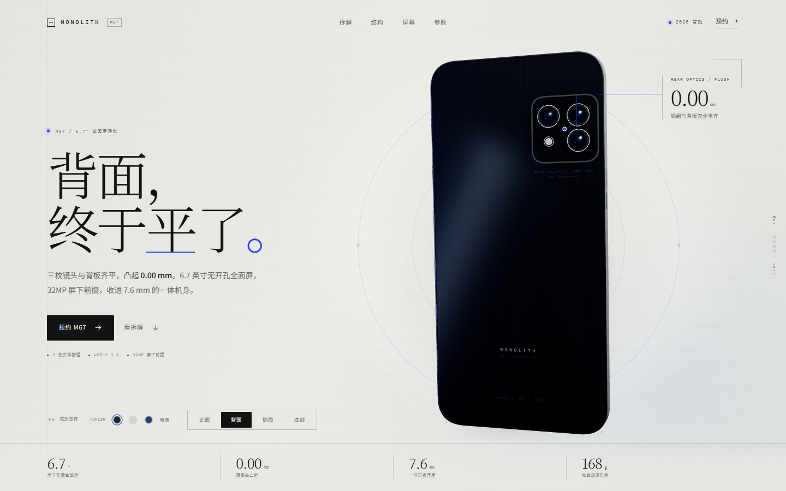
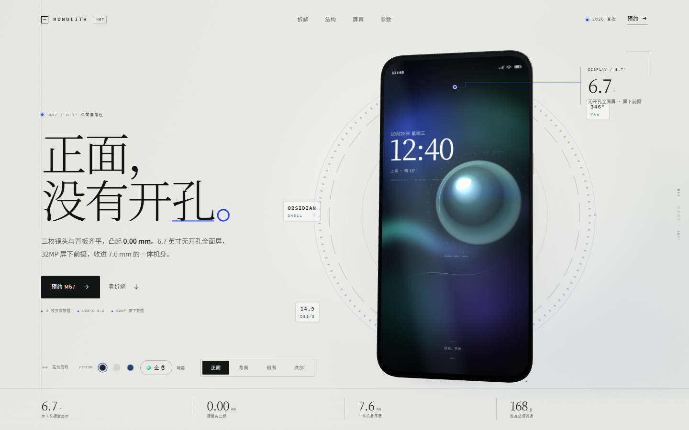
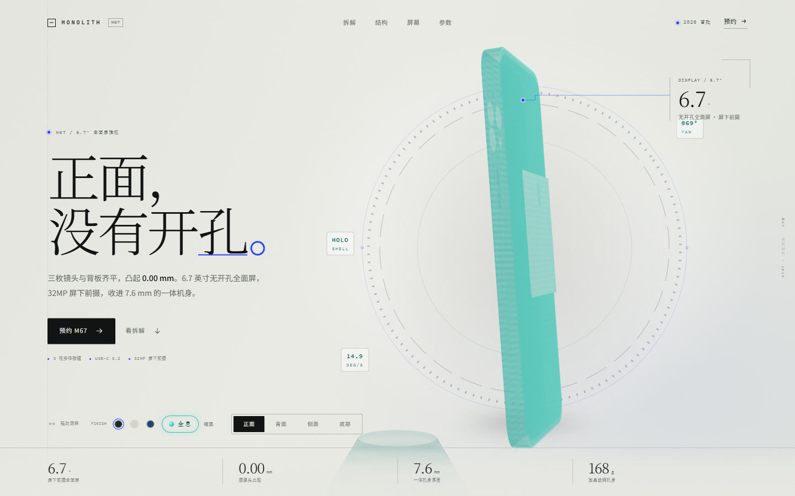
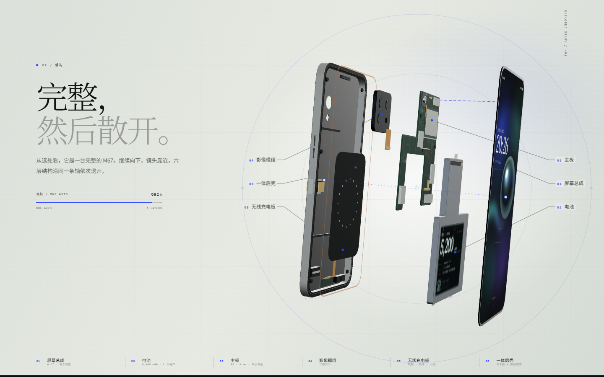
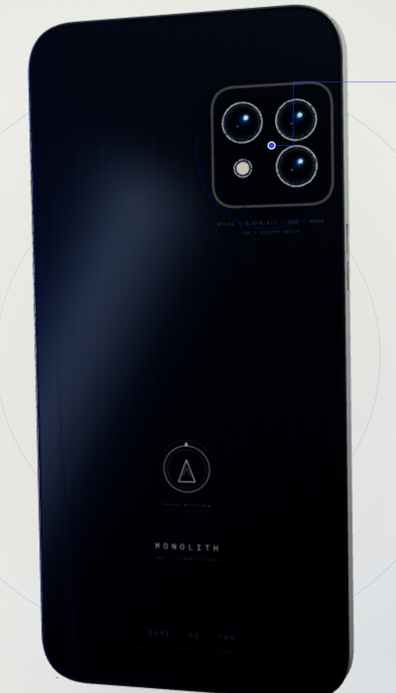
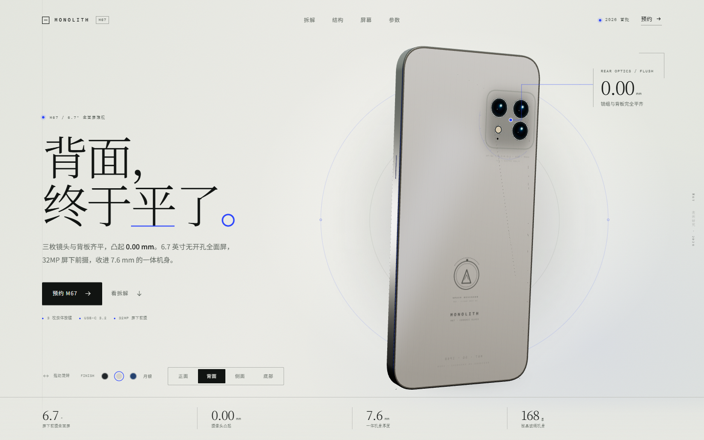
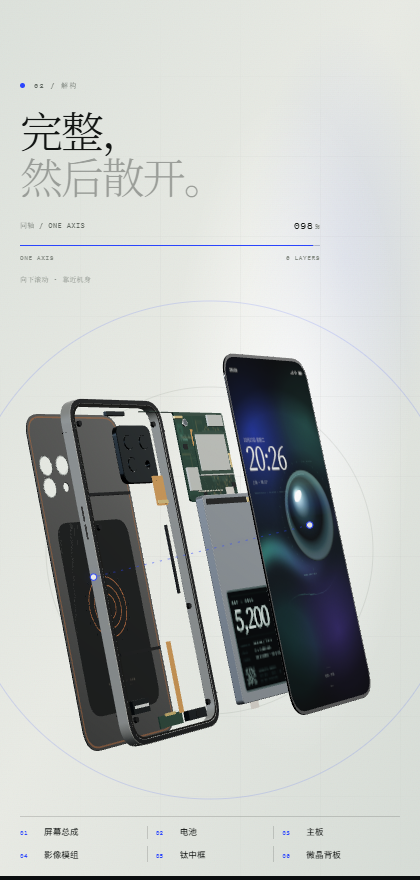

# MONOLITH M67 — 3D 手机展示页

概念手机单页网站。**6.7 英寸屏下前摄全面屏**，三枚镜头与微晶玻璃背板完全齐平，**摄像头凸起 0.00 mm**；**曜黑 / 月银 / 电蓝** 三种配色，**3 枚实体按键**，底部 **USB-C 3.2 Gen 2**。

## 页面展示

**首屏 · 拖拽旋转 / 自动转台 / 跟随鼠标的玻璃光斑**



**活体锁屏 · 真实时钟 + 呼吸光核 ｜ 全息模式 · 菲涅尔边缘 + 扫描线 + 投影锥**




**滚动驱动的六层解构 · 折线引注 ｜ 背面 · 0.00 mm 齐平镜组与太空部门圆章**




**月银配色 ｜ 移动端布局**




> 全部画面实时渲染，预览图为无头浏览器截取。

## 直接打开

双击 **`M67-phone.html`**。

CSS、JavaScript 与 Three.js 已全部内联在这个文件中，无需联网、无需安装依赖，也不需要本地服务器。

## 通过本地服务器预览（可选）

```powershell
node server.mjs
```

然后访问 <http://127.0.0.1:4173>，或双击 `start.bat`。

开发版文件为 `index.html` + `styles.css` + `app.js`，Three.js 位于 `vendor/`。

## 构建单文件版

`M67-phone.html` 由源文件打包生成，不要再手工编辑它：

```powershell
npm install          # 只装 esbuild 一个开发依赖
npm run build        # index.html + styles.css + app.js + three → M67-phone.html
npm run check        # 源文件比产物新时报错退出
```

`npm run check` 可以挂在提交前钩子上，避免改完开发版忘了重新打包 —— 双击打开的还是旧版。

## 交互

- 向下滚动首屏下方的 **「解构」** 章节：镜头会推近，六层结构从完整手机中沿同一条轴退开，再把页面向上滚可重新合体。
- 在手机上拖动旋转；使用左右方向键旋转，上下方向键俯仰。
- **无操作约 2.4 秒后自动缓慢自转**（约 24 秒一圈，先加速再减速）；拖动、方向键或视角按钮会立刻接管，停手后自动恢复。`prefers-reduced-motion` 下不自转。自转经过每个面时，标题与测量卡会跟着切换。
- 按 `1` 看正面，`2` 看背面，`3` 看侧面，`4` 看底部；空格切换正 / 背面。
- 点击「正面 / 背面 / 侧面 / 底部」按钮查看不同角度。底部视角会展示 USB-C、扬声器孔与麦克风孔，大屏下同时出现 I/O 微距标注。
- 点击 **FINISH** 色点切换 **曜黑 / 月银 / 电蓝**；机身背板、钛中框、按键与解构视图同步换色，选择会保存在浏览器本地。
- 背面标注会显示 **0.00 mm 镜组齐平**；正面标注 **6.7″ 屏下前摄全面屏**；侧面标注 **7.6 mm** 与 **3 枚按键**；底部标注 **USB-C**。
- 首屏玻璃上有一道**跟随鼠标的光斑**（着色器实时渲染），自动自转时也在。
- 数据条数字会**滚动入场**：6.7″ / 7.6 mm / 168 g 从 0 数上去，「摄像头凸起 0.00 mm」则从 3.20 **倒数**到 0——这个产品最重要的一句话，用数字讲完。
- 「结构」章节的剖面图**随滚动自绘**：尺寸线、机身、内部模块、标注依次画出，滚动回去会倒放。
- 章节之间有一条**品牌跑马灯**（MONOLITH M67 · 0.00 mm · 屏下前摄 …），纯 CSS 循环。
- 锁屏是**活的**：时钟/日期显示真实当前时间（每分钟刷新），状态栏神经同步数值缓慢漂移，铬球上有随自转惯性摆动的呼吸光核。
- 配色旁有第三个开关「**全息**」：整机切换为青玉玻璃态（菲涅尔边缘 + 扫描线 + 底部投影锥），SHELL 数据牌同步显示 HOLO，再点一次还原。
- 手机外圈是**仪表环**：三枚数据牌实时显示 YAW / DEG·S / SHELL，刻度环随转向反向缓动（<900px 隐藏）。
- 页面加载后一条扫描线自上而下扫过手机，屏幕从过曝亮度落到正常——「设备被激活」的一秒。
- 拖动、键盘、`prefers-reduced-motion`（自转/跑马灯/自绘全部停用）与移动端布局均已处理。
- 「预约 M67」会打开预约弹窗，邮箱校验仅在本机进行，不会发出任何网络请求。

## 设计要点

- 手机背面是无凸起的平面：镜头圈、镜头玻璃与背板处于同一平面，后盖开孔内嵌镜组；镜组带螺纹内壁、微距刻字与一圈极细光学轨道。
- 背面下半部有一个**原创的「太空部门」圆章**（程序化绘制）：轨道环 + 爬升的三角标记 + 虚线弹道与飞行器圆点，配 "SPACE DIVISION / M67 · FLIGHT UNIT 01" 微缩文字，与 MONOLITH 字标同风格。墨色跟随配色切换（曜黑浅墨 / 月银深墨）。页面不使用任何真实公司的商标或机构徽章。
- 6.7″ 屏幕铺满正面，没有刘海或开孔。32MP 前摄完全置于屏下，解构视图的主板上可以看到独立的 UDC 模组。
- **实体按键严格为 3 枚**：左侧音量 +/−，右侧电源。
- 底部有完整的 I/O 细节：内凹 USB-C、金属口沿、钴蓝定位环、扬声器孔、麦克风孔、螺丝与天线断点。
- 三种配色均为实时生成：背板纹理、金属中框、按键、静置光晕与 3D 解构视图共用一套 finish 状态；切换时有短促的光带掠过。
- **解构章节**是一段滚动驱动的 3D 动画：六层结构沿单一 Z 轴分开。
  - **顺序是拆机顺序，不是装配顺序**：屏幕总成取出 → 电池 → 主板 → 影像模组 → 无线充电板 → 一体后壳。内部件是从这个"桶"里一件件拿出来的。
  - **中框与背板是一体件**：钛中框与微晶玻璃背板合成为同一层（`06 一体后壳`），在解构里始终一起移动，不会被拆成两片。原先藏在背板内侧的无线充电 / 天线板因此独立成第 5 层，编号仍是六层。
  - 每层按真实厚度建模（1 单位 = 10 mm），层间间隙按「零件半厚 + 权重间隙」计算，因此 5.7 mm 的中框和 0.9 mm 的主板不会被拉开同样的距离。
  - 内部布局参照 iPhone 的官方零件图（iPhone 15 Pro 内部视图）：**L 形电芯绕开 L 形主板**，两者像两个 L 互相咬合；摄像头压在主板顶部，充电口小板在底边中央，**Taptic Engine 式的长方形线性马达在左下**，下扬声器在右下，听筒在顶边。
  - **标注是折线引注**：零件上一个圆点，一条折线引到版心外的标签（编号 + 名称），不再用压在零件上的圆形徽章。引线画在 WebGL 画布**下层**，所以它会从零件背后穿过去，而不是横切整个解构图。左右两栏按纵向自动摊开避让；宽度不足以容纳两栏时退化为右侧单栏，标签右边界按实测文字宽度夹紧，不会被视口截断。
  - 解构视图用一张**去饱和的影棚环境贴图**（和三配色共用的那张同源），否则大块金属会把环境的蓝色主光镜面反射成塑料蓝。
  - 影像模组做成**带三个镜筒镗孔的金属框**，镜片朝向背板（那是它真正看的方向），从解构视角看到的是镜筒筒身、FPC 与连接器。
  - **屏下前摄是真"屏下"**：32MP 模组带支架与单颗螺丝，装在主板顶端正中、屏幕顶部下方 20 mm 处，正对屏下位置；解构图里用一条**钴蓝虚线光轴**把它和屏幕上对应的一点连起来，明确"这枚镜头是透过屏幕取景的"。装配态屏幕正面没有任何开孔、挖槽或药丸。
  - 主板为**双层堆叠**：主 PCB 上再叠一小块板，四片哑光镍屏蔽罩盖住 SoC / 射频 / PMIC，另有一块**六颗螺丝固定的主板盖板**盖住连接器区。
  - 电池带保护板、连接器与**三条易拉胶拉手**（底部两条、顶部一条），印刷标签覆盖大半个电芯。
  - 中框是**钛外框扩散结合铝内衬**的双层结构，带加强筋、螺纹柱、防水胶圈槽、天线注塑断点、底部 I/O，以及嵌入后沿的微晶玻璃背板。
  - **无线充电 / 天线板**是独立一层：石墨均热片、三圈线圈、**16 颗独立磁铁构成的磁环**、NFC 天线与丝印标签，边缘用卡扣压在后壳内侧。
  - **双卡槽**在左侧边框（音量键下方），按国行 iPhone 的做法做**正反双面卡托**：一个卡托、两面各一个凹槽，两张 nano-SIM 芯片朝外，共用边框上同一个开口（不是两个并排的槽）。解构时两张卡会随进度向两侧拉开，让"双面"看得见；装配态则贴合在卡托两面。
  - 对应的**读卡座也是双面**：上下两片屏蔽板各带一排金手指，中间留出卡托插入的缝；卡座在**主板左臂**上，主板因此在下缘多出一条 0.9 宽的竖条，电池的 L 形长臂相应内收让位。
  - 屏幕总成由铜箔、基板、OLED 与盖板贴合，带驱动 IC 与两条 FPC；副板与影像模组各有自己的排线。
  - 窄屏（< 760 px）下版心没有余量放引注，改由底部图例承担编号；同时加大俯仰角、收窄间距，让六层在竖向空间里错开。
- 画面由矿物纸色、黑曜玻璃与钴蓝测量线组成；结构章节用一张纸质剖面图说明 0.00 mm。
- 手机模型为程序化 Three.js 几何体，全部材质、屏幕壁纸、镜头纹理、电池标签与主板走线均为实时生成，没有外部图片资源。

> M67 为概念设计，非实际产品。页面中的部分配置为设计设定。
